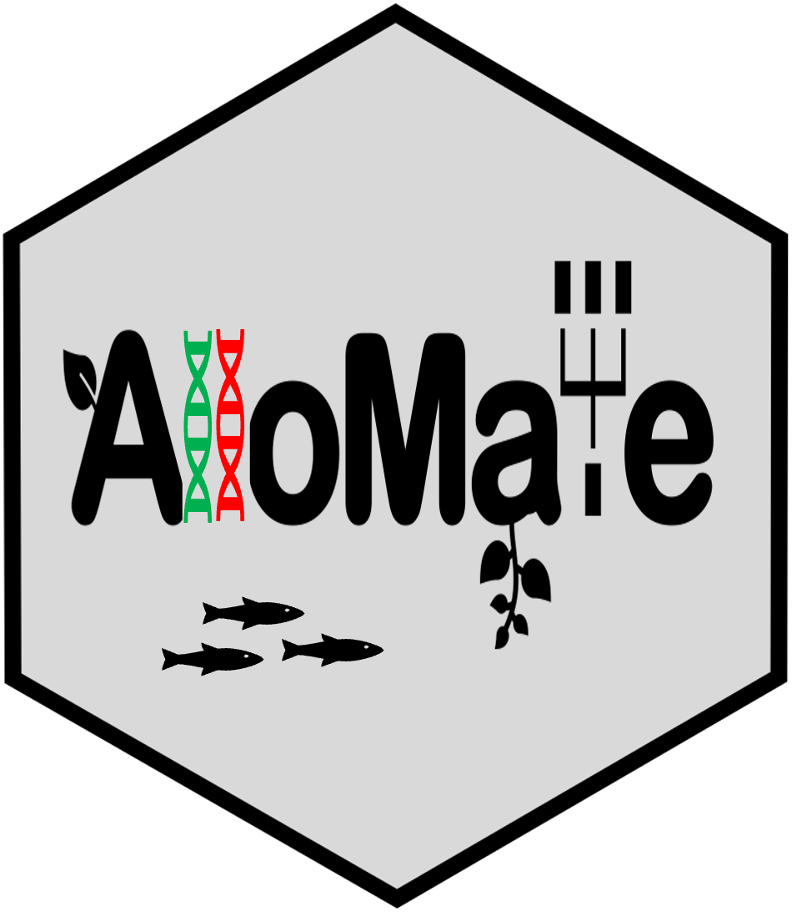

::: {.software-header}
::: {}
AlloMate is a Shiny application for evaluating kinship, combining estimated breeding values, optimizing individual contributions, and producing mating plans under relatedness constraints.


:::

:::

## Start here

### Run locally {.start-option data-step="1"}

To run AlloMate on your own computer, install it from GitHub and start the app in R:

```r
remotes::install_github("Breeding-Insight/AlloMate")
AlloMate::run_app()
```

### Run online {.start-option data-step="2"}

AlloMate also runs online, with no software to install. Access is limited to registered users; to request access, email [bi-science-team@ufl.edu](mailto:bi-science-team@ufl.edu?subject=AlloMate%20access%20request).

[]{.access-note}

[ Use online](https://breeding-insight.github.io/AlloMate/){.btn-bi-primary data-analytics-event="use_online" data-analytics-tool="AlloMate"}

::: {.start-links}
[<i class="bi bi-github" aria-hidden="true"></i> Source code](https://github.com/Breeding-Insight/AlloMate){.btn-bi-secondary}
[<i class="bi bi-tag" aria-hidden="true"></i> Releases](https://github.com/Breeding-Insight/AlloMate/releases){.btn-bi-secondary}
:::

## Good fit for

- Pedigree-based kinship analysis
- Multi-trait selection with weighted breeding values
- Optimum Contribution Selection and constrained mating plans

## Related learning

- [Choose a genomic analysis path](../learn/genomics-path.qmd)
