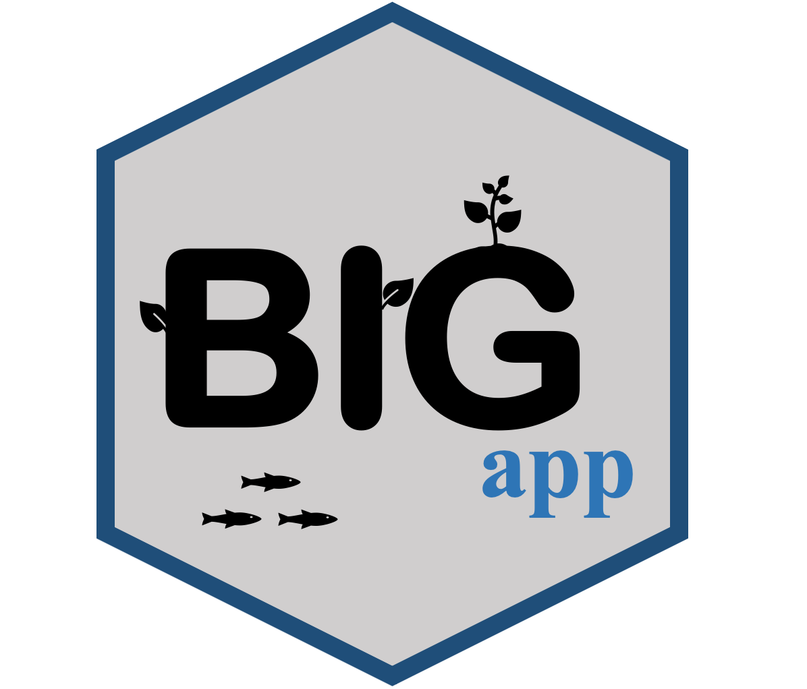

::: {.software-header}
::: {}
BIGapp provides a graphical interface for common genomic analyses, including workflows for population structure, association analysis, genomic prediction, and related tasks.


:::

:::

## Start here

[<i class="bi bi-github" aria-hidden="true"></i> Source code](https://github.com/Breeding-Insight/BIGapp){.btn-bi-primary}
[<i class="bi bi-globe" aria-hidden="true"></i> Breeding Insight software page](https://breedinginsight.org/software/bigapp/){.btn-bi-secondary}

## Good fit for

- Users who prefer an interactive graphical workflow
- Teaching genomic analysis concepts without requiring command-line expertise
- Analyses supported by the BIGr/BIGapp ecosystem

## Related learning

- [Choose a genomic analysis path](../learn/genomics-path.qmd)
