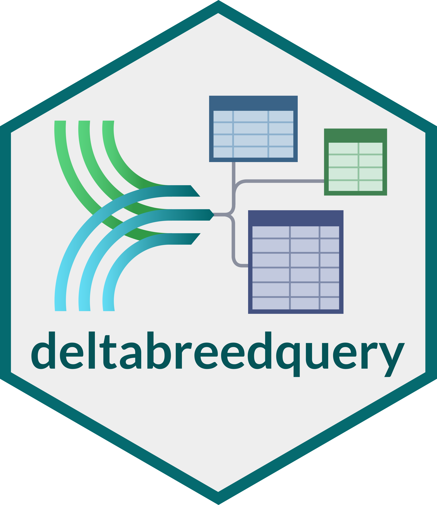

::: {.software-header}
::: {}
The `deltabreedquery` R package provides tools to retrieve data from [DeltaBreed](https://softwarehub.breedinginsight.org/software/deltabreed), 
Breeding Insight's breeding data management platform, using the open-source [BrAPI](https://brapi.org/) standard.

Using `deltabreedquery`, you can import all of a program's experiments, germplasm, trait definitions, 
and observation (phenotype) data directly into R, without the need to reformat or manually download + read in files. 

Observation data can be filtered on a range of common fields: year, location, trial type, etc.


:::

:::

## Start here

To try out the basic functions, install the package from CRAN on any R environment
and load an example program:

```r
install.packages("deltabreedquery")
library(deltabreedquery)

login_deltabreed("example")
expts <- get_experiments()
germ <- get_germplasm()
obs <- get_observations()
filt <- filter_observations(location = "Manitoba", year = 2026)
```

## Learn more

For more detailed instructions on using `deltabreedquery` with a live instance of DeltaBreed,
please see the [GitHub README](https://github.com/Breeding-Insight/deltabreedquery#installation).

For a full list of functions, please see the package's [reference manual on CRAN](https://cran.r-project.org/web/packages/deltabreedquery/refman/deltabreedquery.html).

[<i class="bi bi-github" aria-hidden="true"></i> Source code](https://github.com/Breeding-Insight/deltabreedquery){.btn-bi-secondary}
[<i class="bi bi-box-seam" aria-hidden="true"></i> CRAN](https://cran.r-project.org/package=deltabreedquery){.btn-bi-secondary}
