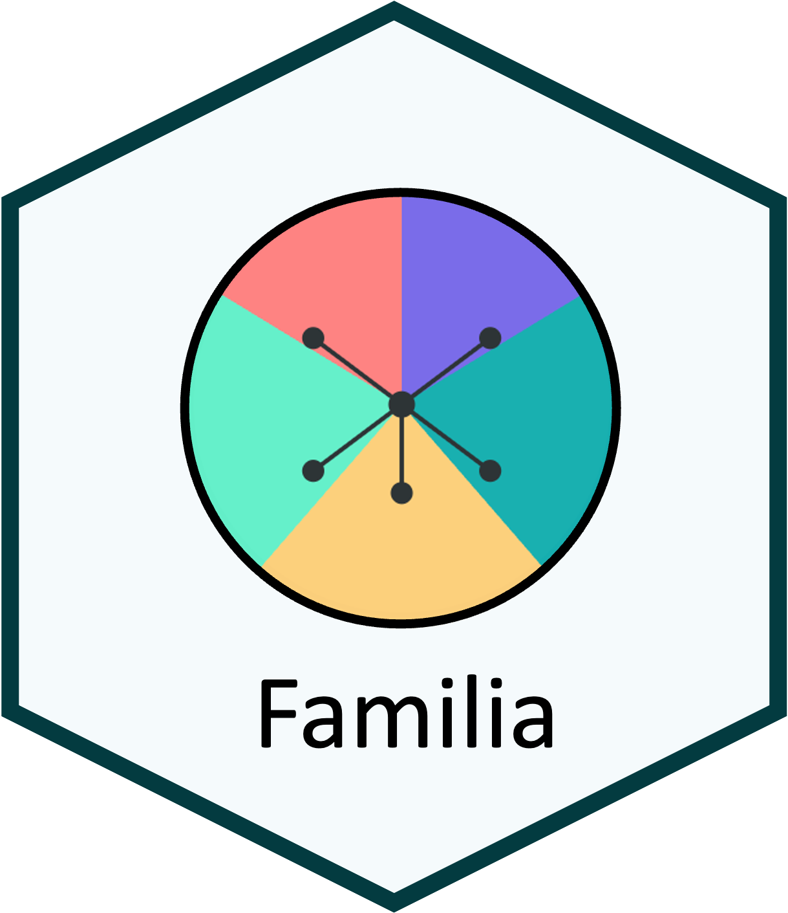

::: {.software-header}
::: {}
Familia is a Shiny application for validating pedigrees, assigning parentage, and assessing supervised or unsupervised ancestry in plant and animal breeding populations.


:::

:::

## Start here

```r
remotes::install_github("Breeding-Insight/Familia")
Familia::run_app()
```

[<i class="bi bi-github" aria-hidden="true"></i> Source code](https://github.com/Breeding-Insight/Familia){.btn-bi-primary}
[<i class="bi bi-tag" aria-hidden="true"></i> Releases](https://github.com/Breeding-Insight/Familia/releases){.btn-bi-secondary}

## Good fit for

- Pedigree cleaning and Mendelian error checks
- Parentage assignment from candidate parent pools
- Breed, line, and population ancestry assessment

## Related learning

- [Choose a genomic analysis path](../learn/genomics-path.qmd)
- [Pedigree validation or parentage assignment?](../learn/pedigree-validation-vs-parentage-assignment.qmd)
- [Validate pedigrees and assign parentage with BIGpopA](../learn/bigpopa-pedigree-parentage.qmd)
