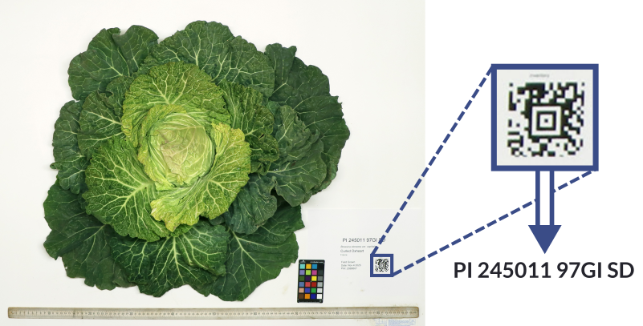
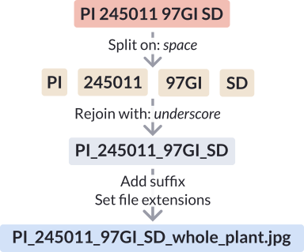

::: {.software-header}
::: {}
Breeding Insight's **QR Image Renamer** was created to help USDA-ARS germplasm curators automatically rename large batches
of image files by reading text from a QR code present in each image, rather than renaming every file by hand.

Access an online version of the app here:

[Launch web app <i class="bi bi-arrow-up-right" aria-hidden="true"></i>](https://grin-image-renamer-516395572783.us-central1.run.app){.btn-bi-launcher target="_blank" rel="noopener" data-analytics-event="use_online" data-analytics-tool="HapApp"}

To save on hosting costs, the web version of the app goes dormant when not in use.
**You may have to wait up to a minute while it starts up again.**


:::
:::

## How it works

The app works by detecting and reading QR codes in each image, then using this text to construct a new filename for each image.

An image must contain exactly one visible, legible QR code (or the similar [Aztec code](https://en.wikipedia.org/wiki/Aztec_Code))
in order for the image to be automatically renamed. In the example below, the QR code encodes the text "PI 245011 97GI SD":

If no QR codes are detected, or if more than one is detected, the image can be renamed manually, excluded from the final set
of renamed images, or included under its original name.

You can then split and rejoin the text using custom characters and make other adjustments as needed:

All filenames can be manually edited before you download the final set of renamed images.

## Technical details

The app's web interface was created with [Gradio](https://gradio.app/), a python library for creating basic web apps designed for machine learning.
The online version is currently hosted on Google Cloud Run, a hosting service designed for containerized web apps.

The pipeline itself consists of two steps:
1. Detect and locate any QR (or Aztec) codes present in the image.
2. If a QR code is found, crop the image and read the text encoded by it.

The base model for QR detection is a YOLO26m model that was trained on 265 images pulled from
the USDA-ARS' [GRIN-Global portal](https://npgsweb.ars-grin.gov/gringlobal/search) and manually annotated
with bounding boxes showing the location of any QR codes present in each image.

QR code parsing is handled by the python [pyrxing](https://pypi.org/project/pyrxing/) library.

To view the source code and learn more, please visit the project's GitHub repository below.

[GitHub](https://github.com/tyrwh/GRIN_image_renamer){.btn-bi-primary}

