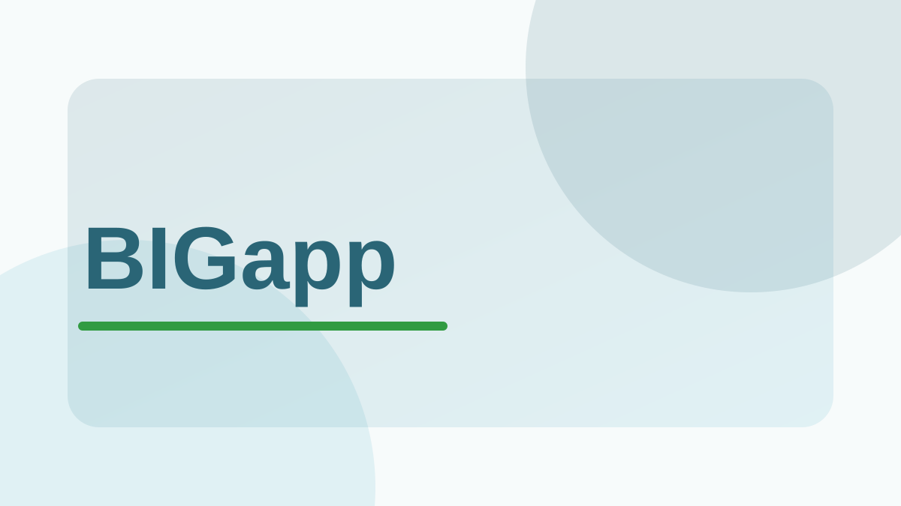

::: {.hub-head .column-screen}
::: {.hub-wrap}
<h1 class="hub-title"></h1>

<p class="hub-subtitle"></p>

Use a workshop when you want a guided sequence of explanations and hands-on exercises. The example files are included so every participant can follow the same analysis.
:::
:::

::: {.hub-body .column-screen}
::: {.hub-wrap .hub-home}

::: {.hub-panel}
<i class="bi bi-envelope" aria-hidden="true"></i>

::: {}
<h2>Request a workshop</h2>

Interested in a workshop for your program or group? Email us at [bi-science@ufl.edu](mailto:bi-science@ufl.edu) and we can discuss options.
:::
:::

::: {.hub-group}
::: {.hub-group-head}
## Available workshops
:::

```{=html}
<div class="hub-items">
  <article class="hub-card hub-card-wide">
    <div class="hub-card-image">
      
    </div>
    <div class="hub-card-body">
    <div class="hub-badges" aria-label="Workshop details">
      <span class="hub-badge hub-badge-eco">Workshop</span>
      <span class="hub-badge">Beginner</span>
      <span class="hub-badge">BIGapp</span>
      <span class="hub-badge">2 hours</span>
    </div>
    <h3><a class="hub-card-link no-external" href="workshops/bigapp/">Introduction to BIGapp for Plant Breeding</a></h3>
    <p class="hub-desc">Import and filter genotype data, explore population structure, run GWASpoly, and try genomic prediction in a two-hour, point-and-click workshop. Local BIGapp installation is required.</p>
    <span class="hub-card-open" aria-hidden="true">Open workshop →</span>
    </div>
  </article>
</div>
```

Looking for a shorter resource? Browse the [Learn library](learn.qmd) for focused concepts, guides, tutorials, and workflows.
:::

:::
:::
